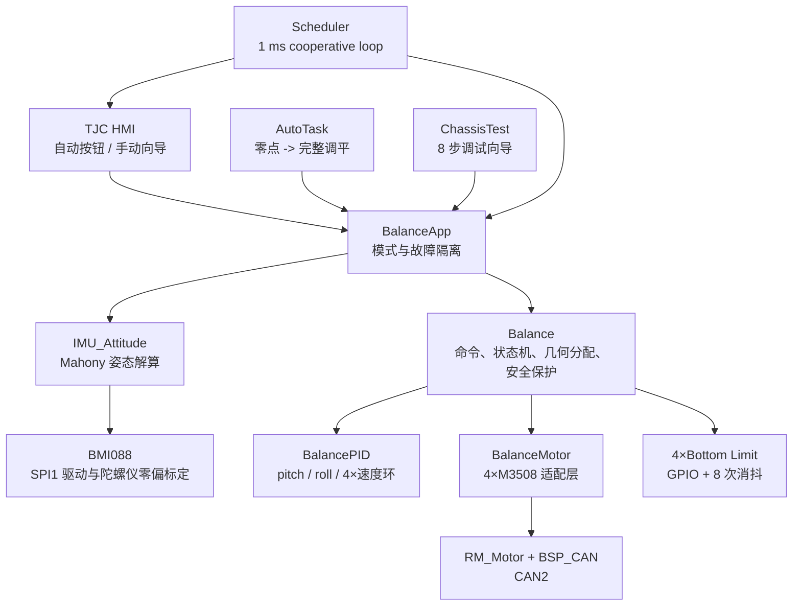
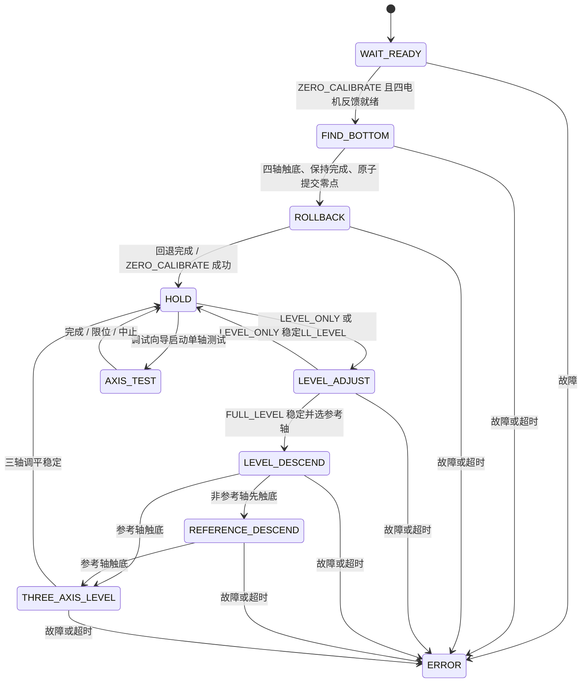

# Dartboard 四轴自动调平系统

> 面向飞镖盘四点升降机构的 STM32F407 裸机调平方案。系统使用 BMI088 测量平台姿态，通过 CAN2 控制四台 M3508 电机，并结合四个底部限位开关完成零点标定、四轴姿态调平、带姿态保持的整体下降以及最终三轴调平。

本文档只描述飞镖调平子系统，不涉及发射、供弹、拉力、记录等其他功能。内容以当前仓库源码为准，既说明“代码如何运行”，也解释“为什么这样设计”，可直接作为 GitHub 项目的调平系统 README。

## 当前状态

| 项目 | 状态 | 说明 |
| --- | --- | --- |
| 调平源码 | 已实现 | 传感器、姿态解算、状态机、四轴电机控制、HMI 与调试向导均已接入 |
| 调度接入 | 已实现 | `BalanceApp_Task()` 以 1 ms 周期运行 |
| 本地编译 | 已通过 | 最近一次 Keil 构建为 `0 Error(s), 0 Warning(s)` |
| 上电自动调平 | 默认关闭 | `BALANCE_AUTO_START_ENABLED = 0`，等待 HMI 或外部接口启动 |
| 实机调平效果 | 需要整机验收 | 电机方向、IMU 安装方向、限位极性、机械行程和 PID 必须按实物确认 |

> [!WARNING]
> 四轴升降机构可能夹伤人员或损坏机械结构。首次运行必须架空或卸载平台，确保急停、电源切断和底部限位有效，并使用低速度、低电流逐轴验证。源码编译通过不等于已完成实机安全认证。

## 1. 设计目标与核心思路

调平对象可抽象为一个由四根独立升降轴支撑的刚性矩形平台：

```text
                FRONT

        FL (0)          FR (1)
          +---------------+
          |               |
          |      IMU      |
          |               |
          +---------------+
        BL (2)          BR (3)

                 BACK
```

系统需要解决四个问题：

1. **不知道绝对高度**：M3508 只提供单圈编码器反馈，因此先用底部限位建立四轴软件零点，再累计编码器得到相对高度。
2. **姿态只有两个自由度、执行器却有四个**：pitch/roll 只有两个控制目标，四个升降轴构成冗余执行机构，因此使用最小范数分配得到总动作量较小的速度组合。
3. **平台最终需要落到底部附近**：先在空中四轴调平，再选最接近底部的轴作为参考轴，保持姿态整体下降，最后固定参考轴并用剩余三轴完成调平。
4. **机械动作必须可控、可中止**：所有动作由显式状态机驱动，统一经过限位、上限、堵转、在线状态、超时、数值有效性和 CAN 发送保护。

完整自动流程为：

```text
ZERO_CALIBRATE -> FULL_LEVEL -> HOLD
```

设计上将“传感器读取”“姿态估计”“调平决策”“速度闭环”“电机通信”和“人机交互”拆分为独立层。这样既能单独验证每层，也能让调平故障只停止 CAN2 的四台调平电机，不拖垮飞镖盘的其他功能。

## 2. 硬件抽象与接口

### 2.1 核心硬件

| 设备 | 当前实现 | 用途 |
| --- | --- | --- |
| MCU | STM32F407 | 运行 1 ms 调平任务和外设驱动 |
| IMU | BMI088 | 加速度与角速度测量 |
| 升降电机 | 4 × DJI M3508 | 驱动四根丝杠/升降轴 |
| 电机总线 | CAN2，1 Mbit/s | 接收电机反馈、发送 `0x200` 电流帧 |
| 底部限位 | 4 × 低电平有效开关 | 建立零点并阻止继续下行 |
| 人机界面 | TJC 串口屏 | 自动调平入口和 8 步调试向导 |

### 2.2 电机、轴和限位映射

四轴顺序是整个系统最重要的约定。几何矩阵、电机 ID、限位 GPIO 和诊断界面必须保持一致。

| 逻辑轴 | 数组索引 | CAN2 电机 ID | 底部限位 | pitch 系数 | roll 系数 |
| --- | ---: | ---: | --- | ---: | ---: |
| `front_left` / FL | 0 | `0x201` | PB12 / `LIMIT_FL` | `+1` | `+1` |
| `front_right` / FR | 1 | `0x202` | PB13 / `LIMIT_FR` | `+1` | `-1` |
| `back_left` / BL | 2 | `0x203` | PB14 / `LIMIT_BL` | `-1` | `+1` |
| `back_right` / BR | 3 | `0x204` | PB15 / `LIMIT_BR` | `-1` | `-1` |

限位输入使用内部上拉，低电平表示触发。当前四轴 `motor_direction[]` 都是 `+1`：

- 目标速度为正：该轴上升；
- 目标速度为负：该轴下降；
- pitch 为正：平台前侧更高；
- roll 为正：平台左侧更高。

如果实机中任一电机安装方向相反，应修改该轴的 `motor_direction[]`，而不是在多个状态函数中分别改符号。

### 2.3 BMI088 连接

| 信号 | 引脚/外设 |
| --- | --- |
| SPI | SPI1：PB3/SCK、PB4/MISO、PA7/MOSI |
| 加速度计片选 | PA4 / `BMI088_ACC_CS` |
| 陀螺仪片选 | PB0 / `BMI088_GRYO_CS` |

当前 CubeMX 配置报告 SPI1 速率为 42 Mbit/s。移植或定版前应结合所用 BMI088 模块、电平转换器、走线质量和器件数据手册复核允许的 SPI 时钟；通信不稳定会直接导致调平子系统进入 IMU 故障。

## 3. 软件架构



### 3.1 分层职责

| 层 | 文件 | 主要职责 |
| --- | --- | --- |
| 业务编排 | `User/balance/balance_app.c` | 初始化子系统、读取 IMU、切换 AUTO/MANUAL/IDLE/FAULT、持续零电流保护 |
| 自动任务 | `User/Test/auto_task.c` | 顺序执行零点标定和完整调平 |
| 核心控制 | `User/balance/balance.c` | 调平状态机、最小范数速度分配、速度闭环和安全保护 |
| 姿态估计 | `User/balance/imu_attitude.c` | Mahony 思路的四元数姿态解算，输出 pitch/roll 及角速度 |
| IMU 驱动 | `User/balance/bmi088.c` | SPI 寄存器配置、采样、量纲换算、陀螺仪零偏校准 |
| 电机适配 | `User/balance/balance_motor.c` | 注册 CAN2 上的 `0x201~0x204`，读取反馈并发送四路电流 |
| 控制器 | `User/balance/balance_pid.c` | 通用 PID、积分限幅、变速积分、积分分离、微分先行和前馈 |
| 调试向导 | `User/Test/chassic_test.c` | CAN、方向、限位、IMU、编码器、标定和调平的逐项验收 |
| 页面适配 | `User/Htim/page_balance.c` | 调平页面按键、文本刷新、短按/长按和离页停止 |
| 周期调度 | `User/CPU/scheduler.c` | 1 ms 控制任务与 10 ms 页面任务调度 |

### 3.2 控制权约束

同一时间只允许一个上层模块向 `Balance` 下达命令：

- `AUTO`：只有 `AutoTask` 控制；
- `MANUAL`：只有 `ChassisTest` 控制；
- `IDLE`：不产生新动作；
- `FAULT`：持续确保四台调平电机输出为零。

模式切换会先中止原任务、发送 `ABORT`，再直接发送一次 CAN2 零电流，避免旧状态或旧电流跨模式残留。

## 4. 启动与周期执行

### 4.1 初始化顺序

`main()` 完成 GPIO、CAN2、SPI1、串口和看门狗初始化后进入 `Scheduler_Init()`。与调平有关的初始化顺序为：

```text
BSP_CAN_Init
    -> RM_Motor_Init
    -> PageBalance_Init
    -> DartboardHMI_Init
    -> BalanceApp_Init
        -> BalanceMotor_Init
        -> Balance_Init
        -> AutoTask_Init
        -> BMI088_Init
            -> 加速度计初始化
            -> 陀螺仪初始化
            -> 1000 次静止零偏采样
        -> IMU_Attitude_Init
```

BMI088 初始化阶段会连续采样约 1 秒并计算陀螺仪零偏。此时平台必须静止；程序会在阻塞校准期间刷新独立看门狗。

`BALANCE_AUTO_START_ENABLED` 当前为 `0`，所以初始化成功后保持 `IDLE`，不会在上电瞬间驱动升降电机。

### 4.2 周期任务

| 任务 | 周期 | 调平相关职责 |
| --- | ---: | --- |
| `BalanceApp_Task` | 1 ms | 电机在线检查、BMI088 读取、姿态更新、`Balance_Update`、自动/手动上层状态机、喂狗 |
| `DartboardHMI_Task` | 1 ms | 解析触摸和页面事件 |
| `PageBalance_Task` | 10 ms | 长按检测与文本刷新 |

调度器为 cooperative loop，而不是硬实时 RTOS。代码中的 PID `dt` 固定为 `0.001 s`，因此应避免其他任务长时间阻塞；否则实际周期与控制器假设不一致。`Balance_Update()` 先执行，`AutoTask_Update()` 或 `ChassisTest_Update()` 后执行，所以新命令会在下一次 1 ms 周期生效。

## 5. 对外控制接口

### 5.1 APP 模式

| 模式 | 含义 |
| --- | --- |
| `BALANCE_APP_MODE_IDLE` | 子系统已就绪但不启动动作 |
| `BALANCE_APP_MODE_AUTO` | 自动执行“零点标定 → 完整调平” |
| `BALANCE_APP_MODE_MANUAL` | 运行串口屏 8 步测试向导 |
| `BALANCE_APP_MODE_FAULT` | 初始化或自动任务故障，调平电机持续停止 |

建议外部业务只调用 APP 层接口：

```c
BalanceApp_Init();
BalanceApp_Task();          // 1 ms 周期
BalanceApp_StartAuto();     // 启动自动调平
BalanceApp_StartManual();   // 进入手动向导
BalanceApp_Stop();          // 中止并归零电流
```

### 5.2 Balance 命令

| 命令 | 行为 | 是否要求有效零点 |
| --- | --- | ---: |
| `BALANCE_COMMAND_IDLE` | 清理控制器并进入停止保持 | 否 |
| `BALANCE_COMMAND_ABORT` | 中止当前动作，结果设为 `ABORTED` | 否 |
| `BALANCE_COMMAND_ZERO_CALIBRATE` | 找底、提交四轴软件零点并回退 | 否 |
| `BALANCE_COMMAND_LEVEL_ONLY` | 只进行四轴原地调平，稳定后结束 | 是 |
| `BALANCE_COMMAND_FULL_LEVEL` | 四轴调平、整体下降、最终三轴调平 | 是 |
| `BALANCE_COMMAND_LEVEL` | `FULL_LEVEL` 的兼容别名 | 是 |

每个新命令都会先发送四路零电流、清空 PID 积分和阶段临时量。已经成功提交的 `zero_ecd[]` 与 `zero_valid` 会保留，直到下一次成功标定覆盖或 MCU 复位。

### 5.3 执行结果

`Balance_GetResult()` 返回：

- `IDLE`：尚未执行；
- `RUNNING`：动作进行中；
- `SUCCEEDED`：动作成功；
- `FAILED`：进入故障状态；
- `ABORTED`：被主动中止。

## 6. 状态机设计



`HOLD` 不是带位置力矩的机械锁定，而是每周期发送四路零电流。是否能保持高度取决于丝杠自锁、减速机构和负载；不要把软件 `HOLD` 当作机械制动器。

## 7. 传感器与姿态解算

### 7.1 BMI088 配置

当前配置为：

- 加速度计：800 Hz，正常带宽，量程 ±6 g；
- 陀螺仪：1000 Hz ODR，约 116 Hz 带宽，量程 ±2000 °/s；
- 加速度量纲：m/s²；
- 角速度量纲：rad/s；
- SPI 单次访问超时：2 ms。

初始化时读取芯片 ID，并采集 1000 次陀螺仪数据计算三个轴的零偏：

- 至少 960 次采样成功；
- 任一轴标准差不得超过 `0.2 rad/s`；
- 校准失败则整个调平 APP 进入 `FAULT`。

### 7.2 Mahony 思路的姿态估计

姿态模块使用四元数积分保存空间姿态：

```text
q_dot = 1/2 * q ⊗ omega
q(k+1) = normalize(q(k) + q_dot * dt)
```

当加速度模长满足：

```text
|norm(accel) - 9.80665| <= 3.0 m/s²
```

加速度方向会参与重力反馈修正，比例增益 `IMU_MAHONY_KP = 2.0`。当平台受到较强平动或振动、加速度模长不可信时，暂时只使用陀螺仪积分，避免错误的重力方向拉偏姿态。

当前传感器轴映射是 `X->X、Y->Y、Z->Z`，三个轴符号均为 `+1`；输出层再令：

```text
pitch_sign = -1
roll_sign  = +1
```

从而满足“前高 pitch 为正、左高 roll 为正”的机械约定。更换 IMU 安装方向时，应优先修改 `IMU_BODY_*_AXIS` 和 `IMU_BODY_*_SIGN`，然后通过调试向导第 4 步验证。

APP 层还要求姿态数据更新时间不超过 20 ms。姿态指针无效、`data_valid == 0` 或数据过期都会把本周期 IMU 标记为不可用。

## 8. 编码器与软件零点

M3508 返回 0～8191 的单圈编码器值。控制器对相邻采样做跨圈展开：

```text
delta = current_ecd - last_ecd

if delta >  4096: delta -= 8192
if delta < -4096: delta += 8192

total_ecd += delta
```

轴的相对高度定义为：

```text
height[i] = (total_ecd[i] - zero_ecd[i]) * motor_direction[i]
```

这里的“高度”单位仍是电机编码器计数，不是毫米。若需要毫米量纲，应显式加入减速比、丝杠导程和传动方向换算，不应直接把 `ECD` 参数命名成物理距离。

## 9. 零点标定算法

零点标定由 `WAIT_READY -> FIND_BOTTOM -> ROLLBACK -> HOLD` 构成。

### 9.1 等待电机反馈

收到 `ZERO_CALIBRATE` 后先发送零电流。只有四台电机都在线且四路编码器累计器已经收到初始反馈，才进入找底阶段。

### 9.2 四轴下行找底

未触底的轴以 `-100 rpm` 下行。某轴的消抖限位首次生效时：

1. 该轴目标速度变为 0；
2. 当前 `total_ecd` 写入 `pending_zero_ecd[i]`；
3. 开始累计 100 个保持周期；
4. 如果保持完成前开关释放，则撤销本次捕获并继续下行。

### 9.3 事务式提交零点

四个轴都触底并各自连续保持 100 个控制周期后，才统一执行：

```text
zero_ecd[i] = pending_zero_ecd[i]
zero_valid  = true
```

这种“临时缓存 → 全部完成 → 一次提交”的方式可避免标定中止时只更新部分轴、破坏上一组有效零点。新命令或 `ABORT` 会清除 `pending_zero_ecd[]`，但不清除已提交零点。

### 9.4 上行回退

提交零点后，四轴以 `+100 rpm` 上行。当某轴满足：

```text
height[i] >= 8192 ECD
```

该轴目标速度归零。四轴都达到回退距离并保持 100 个周期后，标定结果为 `SUCCEEDED`。

## 10. 姿态控制与速度分配

### 10.1 pitch/roll 外环

目标姿态由安装偏置定义：

```text
pitch_error = pitch_offset - pitch
roll_error  = roll_offset  - roll
```

当前偏置均为 0，两个姿态 PID 当前只启用比例项：

```text
pitch_pid: Kp=100, Ki=0, Kd=0, output_limit=200
roll_pid : Kp=100, Ki=0, Kd=0, output_limit=200
```

为抑制平台振荡，又直接引入角速度阻尼：

```text
pitch_cmd = pitch_pid_output - 5 * pitch_rate
roll_cmd  = roll_pid_output  - 5 * roll_rate
```

`pitch_cmd` 和 `roll_cmd` 是待分配的速度修正量，不是电流或力矩。

### 10.2 四轴几何矩阵

几何系数为：

```text
                    FL   FR   BL   BR
pitch_sign =       [+1, +1, -1, -1]
roll_sign  =       [+1, -1, +1, -1]
```

令：

```text
B = [pitch_sign]
    [ roll_sign]

u = [pitch_cmd, roll_cmd]^T
```

要寻找轴速度 `v` 使：

```text
B * v = u
```

因为控制目标只有两个而执行轴有三到四个，方程通常有无穷多组解。当前实现使用最小范数解：

```text
v = B^T * (B * B^T)^-1 * u
```

对称四轴全部参与时可化为：

```text
FL = ( pitch_cmd + roll_cmd) / 4
FR = ( pitch_cmd - roll_cmd) / 4
BL = (-pitch_cmd + roll_cmd) / 4
BR = (-pitch_cmd - roll_cmd) / 4
```

只修正 pitch 时前后反向运动，只修正 roll 时左右反向运动。最小范数解不会主动叠加共同升降分量，因而能减少无意义的整体运动。

当参考轴固定后，代码从 `allowed[]` 中移除该轴，重新计算三轴矩阵的最小范数解，而不是先算四轴结果再把某一路简单置零。若 `B * B^T` 的行列式过小或出现非有限值，则返回 `BALANCE_ERROR_GEOMETRY`。

### 10.3 稳定判定

调平不是单次进入误差带就完成，而是同时满足：

```text
abs(pitch - pitch_offset) <= 0.01 rad
abs(roll  - roll_offset)  <= 0.01 rad
abs(v[i])                 <= 5 rpm  （所有参与轴）
```

并连续保持 500 个控制周期。按理想 1 ms 调度约为 500 ms。任一条件失效都会把稳定计数清零。

## 11. 完整调平流程

### 11.1 阶段一：四轴原地调平

四轴都参与最小范数速度分配，不叠加共同下降速度。姿态连续稳定后：

- `LEVEL_ONLY`：直接返回成功并进入 `HOLD`；
- `FULL_LEVEL`：选择相对高度最小的轴为 `reference_axis`，进入整体下降。

```text
reference_axis = arg min(height[i])
```

该轴在当前姿态下距离底部最近，优先将它作为最终机械参考点。

### 11.2 阶段二：保持调平并整体下降

先计算姿态修正速度，再为所有轴叠加共同下降分量：

```text
speed[i] = level_correction[i] - 50 rpm
```

下降时持续检查四个底部限位：

- 参考轴先触底：停止当前输出，进入最终三轴调平；
- 非参考轴先触底：停止当前输出，进入“参考轴单独下降”；
- 没有轴触底：继续边调平边下降。

### 11.3 阶段二补充：参考轴单独下降

其他三轴目标速度为 0，只让参考轴以 `-50 rpm` 下行。参考轴触底后进入三轴调平。

### 11.4 阶段三：固定参考轴，剩余三轴调平

参考轴速度固定为 0，剩余三轴重新计算最小范数速度。再次连续稳定 500 个周期后，完整调平成功，四轴进入零电流 `HOLD`。

## 12. 电机速度内环与电流输出

姿态层输出的是每轴目标速度。每台电机有独立速度 PID：

```text
speed_error -> speed PID -> motor current command
```

当前参数：

```text
Kp = 5.0
Ki = 0.05
Kd = 0.0
积分输出上限 = 1000
总输出上限   = 2000
```

最终电流命令再次裁剪到 `[-2000, 2000]`，通过 CAN2 的 `0x200` 组帧一次发送给 `0x201~0x204`。这里的 `2000` 是 DJI 电机协议中的原始电流命令值，不应直接解释为 2000 A。

PID 模块还实现了死区、变速积分、积分分离、微分先行和目标前馈，但当前调平参数并未全部启用。

## 13. 安全保护与故障策略

所有运动最终都经过 `Balance_SpeedControl()`。出现不可恢复故障时，统一执行：

```text
result = FAILED
state  = ERROR
four_motor_current = 0
```

### 13.1 保护规则

| 保护 | 当前阈值 | 动作 |
| --- | --- | --- |
| 底部限位消抖 | 连续 8 次，约 8 ms | 低电平稳定后认定触发 |
| 底部方向保护 | 限位触发且目标速度 `< 0` | 该轴速度改为 0，清速度环积分 |
| 顶部软限位预保护 | `height >= 20×8192 - 256 ECD` 且仍要上升 | 该轴速度改为 0，清积分 |
| 顶部越界 | `height > 20×8192 + 256 ECD` | 全部停止，`UPPER_LIMIT` |
| 电机离线 | 任一电机反馈超过 100 ms | 全部停止，`MOTOR_OFFLINE` |
| 电机堵转 | 目标速度 ≥30 rpm、实际速度 ≤5 rpm、反馈电流 ≥1200，连续 300 次 | 全部停止，`MOTOR_STALL` |
| CAN 发送失败 | 电流组帧/发送失败 | 全部停止，`CAN_TX` |
| IMU 无效 | 调平相关状态下数据无效、过期或非有限 | 全部停止，`IMU_OFFLINE` 或 `NONFINITE` |
| 几何求解失败 | 行列式退化或结果非有限 | 全部停止，`GEOMETRY` |
| 状态非法 | 未覆盖状态 | 全部停止，`INVALID_STATE` |

### 13.2 阶段超时

| 阶段 | 超时 |
| --- | ---: |
| 找底 | 15 s |
| 回退 | 10 s |
| 四轴原地调平 | 20 s |
| 保持调平整体下降 | 20 s |
| 参考轴单独下降 | 15 s |
| 最终三轴调平 | 20 s |

### 13.3 故障隔离

调平 APP 初始化失败或自动任务失败后进入 `FAULT`，此后每个 1 ms 周期都会再次发送四路零电流，同时继续刷新看门狗。该策略的目的是让调平故障停止调平机构，但不让整个飞镖盘反复复位。

错误枚举中的 `LIMIT_CONFLICT`、`SCHEDULER` 和 `EMERGENCY_STOP` 当前属于预留项，核心状态机尚未主动产生这些错误。串口屏长按急停目前表现为 `ABORT`、零电流和向导复位。

## 14. 自动模式与手动调试向导

### 14.1 自动模式

首页 `b_auto`（组件 ID 4）松开后调用 `BalanceApp_StartAuto()`：

```text
停止旧任务
    -> 四路电流归零
    -> ZERO_CALIBRATE
    -> 成功后 FULL_LEVEL
    -> COMPLETE / FAULT
```

自动完成后 APP 仍保留在 `AUTO` 模式，但底层已经进入 `HOLD` 并发送零电流，不会自动重复执行。

### 14.2 手动调平页面

首页 `b_balance`（组件 ID 1）进入调平测试页面。源码名称是 `page3`，协议页 ID 为 4。进入页面会中止自动任务并切换到 `MANUAL`。

向导共 8 步：

| 步骤 | 内容 | 主要目的 |
| ---: | --- | --- |
| 1 | CAN 电机在线检查 | 确认四台 M3508 都有反馈 |
| 2 | 四轴正反方向测试 | 每轴依次 `+20/-20 rpm`，确认方向与反馈 |
| 3 | 四个底部限位测试 | 确认 raw 与消抖状态都能变化 |
| 4 | IMU 姿态检查 | 前部抬高 pitch 应为正，左侧抬高 roll 应为正 |
| 5 | 编码器方向检查 | 上升命令应产生预期的正向累计量 |
| 6 | `ZERO_CALIBRATE` | 验证找底、零点提交和回退 |
| 7 | `LEVEL_ONLY` | 只验证四轴原地调平 |
| 8 | `FULL_LEVEL` | 验证完整下降与三轴收敛流程 |

`b_bottom` 操作：

- 短按：开始下一步、重试当前失败步骤；
- 动作运行中短按：立即中止当前步骤；
- 长按 1 秒：停止电机并将向导重置到第 0 步；
- `b_back`：停止调平并返回首页。

第 2 步单轴测试被限制为最大 `20 rpm`、单次最长 `1000 ms`；当前向导实际使用每方向 `250 ms`，中间暂停 `300 ms`。

### 14.3 手动按键逐步操作与变量观察

这一节面向实际调试人员，说明进入调平页面后，每次按下 `b_bottom` 会发生什么、屏幕变量代表什么，以及哪些项目由程序自动判定、哪些必须由操作者确认。

#### 14.3.1 通用按键逻辑

刚进入调平页面时，向导处于第 0 步：

```text
t_step = READY
test_step = 0
test_run = TEST_RUN_IDLE
```

之后按键遵循以下规则：

| 当前情况 | `b_bottom` 操作 | 程序行为 |
| --- | --- | --- |
| 第 0 步或上一步已通过 | 短按并松开 | `test_step++`，启动下一步 |
| 当前步骤失败或被中止 | 短按并松开 | 不增加步骤号，重新执行当前步骤 |
| 当前步骤仍在运行 | 短按并松开 | 立即 `ChassisTest_ForceStop()`，结果记为 `ABORTED` |
| 任意时刻 | 按住至少 1 秒 | 发送 `ABORT`、四轴零电流、清空向导结果并回到第 0 步 |
| 第 8 步已经通过 | 再短按一次 | 生成总结果，`t_step = DONE` |
| 任意时刻 | 松开 `b_back` | 停止调平、退出 MANUAL、返回首页 |

> [!IMPORTANT]
> 长按 1 秒会重置测试向导，但不会清除此前已经成功提交的 `zero_ecd[]` 和 `zero_valid`。如果需要重新建立机械零点，必须再次执行第 6 步，而不能把“向导已复位”理解成“零点已清除”。

向导内部通用变量：

| 变量 | 类型/范围 | 含义 |
| --- | --- | --- |
| `test_step` | `0~9` | 当前步骤；1～8 是测试，9 是汇总 |
| `test_finished` | `0/1` | 是否已经生成最终汇总 |
| `test_run` | `Test_Run_t` | 当前正在运行的测试类型；`IDLE` 表示无动作 |
| `test_result[step]` | `Test_Result_t` | 每一步的 `NONE/RUNNING/PASS/FAIL/ABORTED` |
| `test_start_tick` | ms | 当前定时测试的起始时刻 |
| `test_phase_tick` | ms | 单轴动作阶段切换时刻 |
| `test_print_tick` | ms | 200 ms 屏幕信息刷新基准 |
| `test_message` | 字符串 | 显示在 `t_txt` 的当前提示 |
| `test_message_revision` | 递增计数 | 文本发生变化时触发页面刷新 |

#### 14.3.2 第一次短按：步骤 1，CAN 在线检查

本步骤不会驱动电机。程序依次调用 `Balance_GetAxisDiagnostic()` 检查 FL、FR、BL、BR。

需要关注：

- 四台 M3508 是否全部上电；
- CAN2 双绞线、终端电阻和收发器是否正常；
- 电机 ID 是否依次为 `0x201、0x202、0x203、0x204`；
- 实物安装位置是否与 FL、FR、BL、BR 的 ID 约定一致。

关键变量：

| 变量 | 期望值 | 含义 |
| --- | ---: | --- |
| `diagnostic.online` | 四轴均为 `1` | 电机已注册且反馈未超时 |
| `motor->last_update_tick` | 距当前不超过 100 ms | 最近一次反馈时间 |
| `test_result[1]` | `TEST_RESULT_PASS` | 四轴在线检查通过 |

自动通过条件是四轴 `diagnostic.online != 0`。如果任意一路离线，屏幕显示 Step 1 FAIL；修复电源、CAN2 或 ID 后再次短按会重试步骤 1，不会进入步骤 2。

程序只能确认“ID 在线”，不能自动知道某个 ID 是否安装在正确的物理角。FL/FR/BL/BR 映射必须在后续逐轴动作中人工核对。

#### 14.3.3 第二次短按：步骤 2，四轴正反方向检查

四个轴按 FL → FR → BL → BR 顺序逐个执行：

```text
+20 rpm，250 ms
    -> 零速暂停 300 ms
    -> -20 rpm，250 ms
    -> 零速暂停 300 ms
    -> 下一轴
```

屏幕约每 200 ms 显示：

```text
Step 2: <axis> phase=<n> rpm=<speed> ecd=<total_ecd> limit=<0/1>
```

必须逐轴关注：

1. 屏幕显示 `FL` 时，实际只能是左前轴运动；FR、BL、BR 同理。
2. `+20 rpm` 阶段必须物理向上，`-20 rpm` 阶段必须物理向下。
3. 正向阶段 `rpm` 应主要为正，负向阶段应主要为负。
4. 没有被测试的三根轴不应发生明显运动。
5. 下行前确认轴未压住底部限位；若 `limit=1`，负向动作会被保护中止。
6. 不应出现明显卡滞、异响、反复换向冲击或异常大电流。

`phase` 数字含义：

| `phase` | 枚举 | 当前动作 |
| ---: | --- | --- |
| 0 | `AXIS_PHASE_START_POSITIVE` | 准备启动正向动作 |
| 1 | `AXIS_PHASE_WAIT_POSITIVE` | 正向动作进行中 |
| 2 | `AXIS_PHASE_PAUSE_POSITIVE` | 正向完成后的暂停 |
| 3 | `AXIS_PHASE_START_NEGATIVE` | 准备启动负向动作 |
| 4 | `AXIS_PHASE_WAIT_NEGATIVE` | 负向动作进行中 |
| 5 | `AXIS_PHASE_PAUSE_NEGATIVE` | 负向完成后的暂停 |

关键变量：

| 变量 | 含义 |
| --- | --- |
| `test_axis` | 当前轴，`0/1/2/3 = FL/FR/BL/BR` |
| `test_axis_phase` | 当前正转、暂停或反转阶段 |
| `diagnostic.speed_rpm` | 当前电机反馈速度 |
| `diagnostic.total_ecd` | 已展开的多圈编码器累计值 |
| `diagnostic.bottom_limit_active` | 消抖后的底部限位状态 |
| `test_positive_peak[axis]` | 测试期间记录的最大正速度 |
| `test_negative_peak[axis]` | 测试期间记录的最小负速度 |
| `test_encoder_start[axis]` | 本轴开始测试时的累计编码器值 |
| `test_encoder_delta[axis]` | 一次正反动作结束后的净编码器变化 |
| `Balance_GetAxisTestResult()` | 单轴动作是否被限位、离线、堵转等保护中止 |

> [!CAUTION]
> 当前代码只要每次单轴测试返回 `BALANCE_AXIS_TEST_SUCCEEDED`，四轴序列完成后就会把步骤 2 标记为 PASS。`test_positive_peak[]`、`test_negative_peak[]` 和物理升降方向尚未参与自动通过判定。因此，即使电机接反但能正常旋转，页面仍可能显示 PASS；操作者必须人工确认“正向上升、负向下降”和轴位置映射。

若发现任一轴方向或位置错误，应在动作仍运行时短按一次中止，修正 CAN ID、接线或 `motor_direction[]` 后，再短按重试本步骤。

#### 14.3.4 第三次短按：步骤 3，底部限位检查

启动步骤 3 前先释放全部限位开关。短按后有 5 秒操作窗口，应依次按下并释放 FL、FR、BL、BR 四个底部开关。

屏幕显示：

```text
raw=FL FR BL BR    active=FL FR BL BR
```

实际显示为连续四位，例如：

```text
raw=1000 active=1000
```

表示 FL 已触发，其他三轴未触发。

需要关注：

- 未按开关时对应 `raw=0`；按下时变成 `raw=1`；
- `active` 是经过 8 个 1 ms 周期消抖后的状态，允许比 `raw` 晚约 8 ms；
- 按 FL 时只能是第一位变化，FR/BL/BR 分别对应第二、三、四位；
- 开关释放后 `raw` 和 `active` 应回到 0；
- 5 秒内每个开关必须至少被观察到一次释放和一次按下。

关键变量：

| 变量 | 含义 |
| --- | --- |
| `diagnostic.bottom_limit_raw` | GPIO 原始值经过“低电平有效”转换后的逻辑状态 |
| `diagnostic.bottom_limit_active` | 8 次连续采样消抖后的有效状态 |
| `test_limit_high[axis]` | 本次测试是否曾观察到 `raw=1`；名称中的 high 不代表 GPIO 高电平 |
| `test_limit_low[axis]` | 本次测试是否曾观察到 `raw=0` |
| `TEST_LIMIT_MONITOR_DURATION_MS` | 固定 5000 ms |

自动通过条件为每轴：

```text
test_limit_high[axis] && test_limit_low[axis]
```

若某一位不变化，优先检查轴映射、常开/常闭接法、PB12～PB15 引脚和公共地。步骤失败后再次短按会重新开始新的 5 秒窗口。

#### 14.3.5 第四次短按：步骤 4，IMU 数据与方向检查

本步骤持续 6 秒。期间缓慢抬高平台前侧，再缓慢抬高左侧，观察：

```text
pitch=<rad> roll=<rad> pitchRate=<rad/s> rollRate=<rad/s> valid=<0/1>
```

需要关注：

1. 静止时 `valid=1`，pitch/roll 不应剧烈跳变。
2. 抬高前侧时 `pitch` 应变为正；压低前侧时应变为负。
3. 抬高左侧时 `roll` 应变为正；压低左侧时应变为负。
4. 快速改变 pitch/roll 时，对应 `pitchRate/rollRate` 符号应与角度变化趋势一致。
5. 回到原姿态后角度应能稳定回到原读数附近，不应持续快速漂移。

关键变量：

| 变量 | 含义 |
| --- | --- |
| `imu->pitch` | 俯仰角，单位 rad，前高为正 |
| `imu->roll` | 横滚角，单位 rad，左高为正 |
| `imu->pitch_rate` | pitch 角速度，单位 rad/s |
| `imu->roll_rate` | roll 角速度，单位 rad/s |
| `imu_valid` | 本周期 BMI088 读取与姿态更新是否有效 |
| `imu->data_valid` | 姿态对象内部有效标志 |
| `test_imu_sample_count` | 6 秒内总采样周期数 |
| `test_imu_valid_count` | 其中有效样本数 |

自动通过条件只有一项：

```text
test_imu_valid_count / test_imu_sample_count >= 95%
```

> [!CAUTION]
> 程序不会自动判定 pitch/roll 的物理正负号，也不会判断零偏是否足够小。即使 IMU 装反，只要有效样本比例达到 95%，步骤 4 仍会显示 PASS。操作者必须人工确认方向；方向不符时修改 `IMU_BODY_*_AXIS`、`IMU_BODY_*_SIGN` 或输出符号后重新测试。

#### 14.3.6 第五次短按：步骤 5，编码器高度方向检查

四个轴再次按 FL → FR → BL → BR 顺序执行，但本步骤只给每轴一次 `+20 rpm、250 ms` 的上升命令，随后暂停 300 ms。

每个轴完成时屏幕显示：

```text
Step 5: <axis> encoder delta=<value>; physical direction must be UP
```

运行中还会显示：

```text
<axis> rpm=<speed> total=<total_ecd> limit=<0/1>
```

必须关注：

- 实际机构确实向上，而不是向下；
- `diagnostic.speed_rpm` 在动作阶段主要为正；
- `test_encoder_delta[axis]` 必须为正且明显不为 0；
- 四个轴的 delta 数量级应大致相近，差异过大可能表示机械阻力、丢反馈或电机参数不一致；
- 当前测试轴与实物 FL/FR/BL/BR 一致。

关键变量：

| 变量 | 计算/含义 |
| --- | --- |
| `test_encoder_start[axis]` | 该轴上升前的 `total_ecd` |
| `diagnostic.total_ecd` | 该轴动作后的多圈累计值 |
| `test_encoder_delta[axis]` | `total_ecd - test_encoder_start[axis]` |
| `diagnostic.speed_rpm` | 电机实际速度反馈 |
| `diagnostic.bottom_limit_active` | 底部限位状态 |

> [!CAUTION]
> 当前代码没有用 `test_encoder_delta[axis] > 0` 作为自动通过条件。只要四次正向单轴测试没有被保护中止，步骤 5 就会显示 PASS。因此必须人工确认每个 delta 都为正；如果为负，应修正方向约定，否则后续 `height`、软上限和参考轴选择都会错误。

#### 14.3.7 第六次短按：步骤 6，零点标定

本步骤下发 `BALANCE_COMMAND_ZERO_CALIBRATE`。开始前应确保四根轴都有足够的下行和回退空间，人员与工具已离开机构。

屏幕约每 200 ms 显示：

```text
Step 6: state=<name> result=<n> error=<n> zero=<0/1>
```

正常状态顺序：

```text
WAIT_READY
    -> FIND_BOTTOM
    -> ROLLBACK
    -> HOLD
```

需要关注：

1. `WAIT_READY` 很快结束；若长时间不动，检查四电机在线和编码器是否初始化。
2. `FIND_BOTTOM` 中四轴应向下；某轴限位触发后该轴停止，未触底轴继续下行。
3. 所有轴都稳定触底约 100 ms 后，`zero_ecd[]` 才一次性提交。
4. `ROLLBACK` 中四轴分别向上回退约 8192 ECD，先到达的轴先停止。
5. 最终进入 `HOLD`，`result=2`、`error=0`、`zero=1`。

关键变量：

| 变量 | 期望/含义 |
| --- | --- |
| `balance.zero_found[4]` | 每轴是否已捕获底部限位 |
| `balance.pending_zero_ecd[4]` | 尚未统一提交的临时零点 |
| `balance.zero_hold_count[4]` | 限位连续保持周期 |
| `balance.zero_ecd[4]` | 已提交的软件零点 |
| `balance.zero_valid` / 屏幕 `zero` | 是否存在有效零点 |
| `balance.rollback_done[4]` | 各轴是否完成回退 |
| `Balance_GetState()` | 当前底层状态 |
| `Balance_GetResult()` | 当前命令结果 |
| `Balance_GetError()` | 失败原因 |

如果此前已经完成过标定，重新执行第 6 步时 `zero` 可能从开始就是 1，因为旧零点会一直保留到新零点完整提交。此时不能只看 `zero` 判断本次标定是否成功，应以状态是否完整经过 `FIND_BOTTOM -> ROLLBACK -> HOLD` 且 `result=2` 为准。

#### 14.3.8 第七次短按：步骤 7，四轴静态调平

本步骤下发 `BALANCE_COMMAND_LEVEL_ONLY`，只验证四轴原地姿态调平，不执行整体下降。

正常状态顺序：

```text
LEVEL_ADJUST -> HOLD
```

需要关注：

- 启动前 `zero=1`；否则会立即失败并显示 `error=16`；
- pitch 为正时，电机组合应把前侧降下或后侧抬起，使 pitch 误差减小；
- roll 为正时，电机组合应把左侧降下或右侧抬起，使 roll 误差减小；
- 平台不应持续整体上升或整体下降；
- 误差接近零时速度应逐渐减小，不应发生持续振荡；
- 连续稳定约 500 ms 后进入 `HOLD`，显示 `result=2、error=0`。

重点变量：

| 变量 | 关注点 |
| --- | --- |
| `balance.pitch/roll` | 是否向 0 或配置偏置收敛 |
| `pitch_output/roll_output` | 姿态 PID 与角速度阻尼后的修正量 |
| `speed[FL/FR/BL/BR]` | 四轴最小范数分配结果是否符合几何方向 |
| `balance.stable_count` | 条件不满足时应清零，达到 500 才成功 |
| `balance.motor_current[4]` | 是否在 ±2000 内且没有长期饱和 |
| `Balance_GetError()` | 振荡超时通常为 `LEVEL_TIMEOUT` |

向导屏幕当前不直接显示 pitch、roll、四轴 speed 和 current；需要进一步调参时，建议临时加入串口/CAN 遥测，或在调试器中观察上述变量。

#### 14.3.9 第八次短按：步骤 8，完整调平

本步骤下发 `BALANCE_COMMAND_FULL_LEVEL`。它会执行四轴调平、保持姿态整体下降、必要时参考轴单独下降，以及最终三轴调平。

正常状态路径之一：

```text
LEVEL_ADJUST
    -> LEVEL_DESCEND
    -> THREE_AXIS_LEVEL
    -> HOLD
```

如果非参考轴先触底，则路径为：

```text
LEVEL_ADJUST
    -> LEVEL_DESCEND
    -> REFERENCE_DESCEND
    -> THREE_AXIS_LEVEL
    -> HOLD
```

需要关注：

1. `LEVEL_ADJUST`：先把 pitch/roll 调到稳定范围，不应一开始就整体下落。
2. `LEVEL_DESCEND`：四轴整体向下，同时继续抑制姿态误差。
3. `reference_axis`：应是四轴调平稳定时 `height` 最小、最接近底部的轴。
4. 若非参考轴先触底：应立即停止四轴混合下降，只让参考轴继续下行。
5. `THREE_AXIS_LEVEL`：参考轴保持不动，另外三轴完成最终姿态修正。
6. 最终 `HOLD`：`result=2、error=0`，四轴电流命令归零。

重点变量：

| 变量 | 关注点 |
| --- | --- |
| `balance.reference_axis` | `0/1/2/3 = FL/FR/BL/BR`；进入 `LEVEL_DESCEND` 时确定 |
| `Balance_GetHeight(axis)` | 选择参考轴时使用的相对高度 |
| `balance.bottom_limit[4]` | 判断参考轴或非参考轴是否先触底 |
| `allowed[4]` | 三轴调平时参考轴为 0，其余轴为 1 |
| `balance.stable_count` | 四轴和三轴阶段分别重新累计 |
| `state/result/error/zero` | 屏幕上判断流程、结果与故障的主要变量 |

只要发现机构方向不对、限位触发后仍有危险运动或平台振荡增大，应立即短按中止；不要等待超时保护。

#### 14.3.10 屏幕数字速查

步骤 6～8 的 `state` 已显示为名称，但 `result` 和 `error` 仍是数字。

`result`：

| 数值 | 枚举 | 含义 |
| ---: | --- | --- |
| 0 | `BALANCE_RESULT_IDLE` | 空闲 |
| 1 | `BALANCE_RESULT_RUNNING` | 运行中 |
| 2 | `BALANCE_RESULT_SUCCEEDED` | 成功 |
| 3 | `BALANCE_RESULT_FAILED` | 失败 |
| 4 | `BALANCE_RESULT_ABORTED` | 被中止 |

`error`：

| 数值 | 枚举 | 常见排查方向 |
| ---: | --- | --- |
| 0 | `BALANCE_ERROR_NONE` | 无错误 |
| 1 | `MOTOR_OFFLINE` | CAN2、电机电源、ID、反馈超时 |
| 2 | `IMU_OFFLINE` | SPI、BMI088、姿态数据超过 20 ms |
| 3 | `FIND_BOTTOM_TIMEOUT` | 找底 15 s 未完成、限位或方向错误 |
| 4 | `ROLLBACK_TIMEOUT` | 回退 10 s 未完成、编码器或机械卡滞 |
| 5 | `LEVEL_TIMEOUT` | 四轴调平 20 s 未稳定、方向/PID/IMU 问题 |
| 6 | `LEVEL_DESCEND_TIMEOUT` | 整体下降 20 s 未触底 |
| 7 | `REFERENCE_DESCEND_TIMEOUT` | 参考轴下降 15 s 未触底 |
| 8 | `THREE_AXIS_TIMEOUT` | 最终三轴调平 20 s 未稳定 |
| 9 | `UPPER_LIMIT` | 相对高度超过顶部软限位容许区 |
| 10 | `MOTOR_STALL` | 目标有速度但实际近零且电流较大 |
| 11 | `CAN_TX` | CAN2 电流帧发送失败 |
| 12 | `LIMIT_CONFLICT` | 回退达到目标后底部限位仍未释放 |
| 13 | `INVALID_STATE` | 状态或命令非法 |
| 14 | `SCHEDULER` | 预留，当前核心状态机未主动产生 |
| 15 | `EMERGENCY_STOP` | 预留；当前长按主要表现为 ABORT |
| 16 | `NO_VALID_ZERO` | 未成功标定就启动步骤 7/8 |
| 17 | `NONFINITE` | pitch/roll/角速度出现 NaN 或 Inf |
| 18 | `GEOMETRY` | 速度分配矩阵退化或计算结果无效 |
| 19 | `MOTOR_OVERHEAT` | 调平电机反馈温度达到 80 ℃ |

步骤 6～8 的成功结束判据统一为：

```text
state  = HOLD
result = 2
error  = 0
```

其中步骤 6 还必须确认本次标定流程真实完成，步骤 7/8 则必须确认 `zero=1`。

## 15. 参数总表

以下参数目前都是源码中的编译期宏，尚未做成运行时配置。

### 15.1 运动与机械参数

| 参数 | 当前值 | 含义 |
| --- | ---: | --- |
| `ZERO_DOWN_SPEED` | 100 rpm | 找底速度幅值 |
| `ZERO_ROLLBACK_SPEED` | 100 rpm | 离开底部限位的回退速度 |
| `ZERO_ROLLBACK_ECD` | 8192 ECD | 回退一个编码器圈 |
| `ZERO_HOLD_COUNT` | 100 | 触底/回退后的连续保持周期 |
| `LEVEL_SPEED_LIMIT` | 200 rpm | 单轴调平修正速度上限 |
| `LEVEL_DESCEND_SPEED` | 50 rpm | 整体或参考轴下降速度 |
| `UPPER_SOFT_LIMIT_ECD` | 163840 ECD | 约 20 个编码器圈的软件上限 |
| `UPPER_LIMIT_MARGIN_ECD` | 256 ECD | 软限位预留边界 |
| `MOTOR_CURRENT_LIMIT` | 2000 | DJI 原始电流命令限幅 |

### 15.2 姿态与稳定参数

| 参数 | 当前值 | 含义 |
| --- | ---: | --- |
| `PITCH_LEVEL_OFFSET` | 0 rad | 物理水平时的目标 pitch |
| `ROLL_LEVEL_OFFSET` | 0 rad | 物理水平时的目标 roll |
| `PITCH_TOLERANCE` | 0.01 rad | pitch 稳定容差，约 0.573° |
| `ROLL_TOLERANCE` | 0.01 rad | roll 稳定容差，约 0.573° |
| `LEVEL_SPEED_DEADBAND` | 5 rpm | 稳定判定的修正速度上限 |
| `LEVEL_STABLE_COUNT` | 500 | 连续稳定周期数 |
| 角速度阻尼 | 5 | `pitch_rate` / `roll_rate` 的直接反馈系数 |

### 15.3 在线、堵转与测试参数

| 参数 | 当前值 |
| --- | ---: |
| `MOTOR_OFFLINE_TIMEOUT_MS` | 100 ms |
| `BALANCE_IMU_TIMEOUT_MS` | 20 ms |
| `STALL_TARGET_SPEED_MIN` | 30 rpm |
| `STALL_ACTUAL_SPEED_MAX` | 5 rpm |
| `STALL_CURRENT_MIN` | 1200 |
| `STALL_CONFIRM_COUNT` | 300 个周期 |
| `LIMIT_DEBOUNCE_COUNT` | 8 个周期 |
| `AXIS_TEST_SPEED_LIMIT` | 20 rpm |
| `AXIS_TEST_DURATION_MAX_MS` | 1000 ms |

## 16. 推荐调试与调参流程

不要直接从完整自动调平开始。推荐严格按以下顺序推进：

1. **断开机械负载检查接线**：核对 CAN2、四个电机 ID、限位上拉与低有效逻辑。
2. **执行向导第 1 步**：确认四台电机持续在线，避免把 ID 或总线问题误判成控制问题。
3. **低速逐轴测试方向**：确认 FL/FR/BL/BR 对应无误，正速度确实上升，负速度确实下降。
4. **验证所有底部限位**：分别按下和释放，确认 raw 状态与 8 次消抖后的 active 状态一致。
5. **验证编码器符号**：向上运动时 `height` 应增加；若不一致，统一修改 `motor_direction[]`。
6. **静置完成 IMU 校准**：检查静止时 pitch/roll 稳定、角速度接近 0。
7. **验证姿态符号**：抬高前侧 pitch 必须为正；抬高左侧 roll 必须为正。符号错误时先改 IMU 轴映射，不要反向调 PID。
8. **只调速度内环**：在安全电流下让四轴速度响应一致，先解决机械阻力差异和振荡。
9. **只运行 `LEVEL_ONLY`**：先用较小姿态 Kp 和较低速度上限，确认几何分配方向正确，再增加响应速度。
10. **设置姿态偏置**：用外部水平仪测得物理水平时的 IMU 读数，写入 `PITCH_LEVEL_OFFSET` 和 `ROLL_LEVEL_OFFSET`。
11. **最后运行 `FULL_LEVEL`**：从较低 `LEVEL_DESCEND_SPEED` 开始，验证参考轴选择、先触底分支和最终三轴调平。
12. **逐项制造故障**：断开一台电机、遮断 IMU、触发限位、模拟堵转，确认都能在预期时间内归零电流。

建议每次只调整一类参数，并记录初始姿态、负载、峰值速度、收敛时间、稳态误差和是否触发保护。不要同时修改姿态 Kp、速度环 PI 和下降速度，否则难以判断问题来源。

## 17. 验收场景

### 17.1 功能验收

1. 上电后四台调平电机保持零电流，不自行运动。
2. BMI088 初始化时移动平台，校准应失败或数据质量明显不合格；静置后可正常初始化。
3. 四台电机 ID 为 `0x201~0x204` 时均可在线；缺少任一台不得开始有效运动。
4. 四轴正速度上升、负速度下降，轴位置与 FL/FR/BL/BR 映射一致。
5. 每个底部限位连续有效约 8 ms 后生效，释放后状态恢复。
6. 标定开始时已有轴触底，该轴应立即进入零速保持，其他轴继续下行。
7. 标定中某轴限位抖动并在 100 个保持周期前释放，该轴应重新找底。
8. 四轴全部稳定触底前中止，旧的已提交零点必须保留。
9. 四轴全部稳定触底后一次性提交零点，再分别回退 8192 ECD。
10. 未完成有效零点标定时执行 `LEVEL_ONLY/FULL_LEVEL`，系统不得运动并返回 `NO_VALID_ZERO`。
11. 只产生 pitch 误差时前后轴反向修正；只产生 roll 误差时左右轴反向修正。
12. `LEVEL_ONLY` 连续稳定约 500 ms 后成功并归零电流。
13. `FULL_LEVEL` 四轴调平稳定后选择 `height` 最小轴作为参考轴。
14. 非参考轴先触底时，系统切换为仅参考轴下降。
15. 参考轴触底后固定，剩余三轴重新分配速度并完成调平。

### 17.2 安全验收

1. 任一底部限位触发后，该轴不能继续收到负速度目标。
2. 有效零点建立后，任一轴达到顶部预保护区时不能继续上升。
3. 任一电机反馈中断超过 100 ms，四路电流全部归零。
4. IMU 数据在调平阶段失效或超过 20 ms 未更新，四路电流全部归零。
5. 堵转条件连续成立约 300 ms，四路电流全部归零。
6. 每个状态超过规定时间，四路电流全部归零并返回对应错误码。
7. CAN2 发送失败时进入 `ERROR`，不得继续使用旧电流输出。
8. 调平页面返回、运行中短按中止、长按急停都能立即归零电流。
9. 调平子系统进入 `FAULT` 后，发射等其他业务仍能继续调度，不发生整机复位循环。

## 18. 已知边界与后续改进

当前实现已经具备完整控制链，但仍有以下工程边界：

1. **参数全部硬编码**：机械行程、PID、姿态偏置和保护阈值都在 `.c` 文件中。建议集中到 `balance_config.h` 或配置结构体，并记录参数版本。
2. **零点不跨上电保存**：`zero_ecd[]` 只存在 RAM 中。每次 MCU 复位后都必须重新标定，这是安全但耗时的策略；如需持久化，必须同时设计机械未移动检测、版本号和 CRC，不能简单写 Flash 后直接信任。
3. **控制周期使用固定 dt**：姿态解算和 PID 都假设 1 ms。建议以后测量真实周期并统计最大抖动，必要时使用定时器中断或 RTOS 周期任务。
4. **缺少运行时遥测**：目前主要通过串口屏向导观察。建议增加状态、错误码、四轴高度/速度/电流、pitch/roll 和参考轴的串口或 CAN 调试输出。
5. **部分错误码仅预留**：`SCHEDULER`、`EMERGENCY_STOP` 尚未形成独立检测链。
6. **温度保护仍为固定阈值**：当前达到 80 ℃直接锁存故障，尚未实现分级降额和温度滞回。
7. **HMI 自动按钮依赖屏工程**：固件已处理首页 ID 4 的 `b_auto` 事件，但串口屏工程必须实际发送对应松开事件。
8. **SPI 时钟需硬件复核**：当前工程配置为 42 Mbit/s，应在正式硬件上确认通信裕量。
9. **尚无自动化算法测试**：建议将几何分配、编码器跨圈、零点事务提交和状态超时抽离成可在 PC 上运行的单元测试。
10. **实机结果未由构建日志证明**：`0 Error/0 Warning` 只说明固件成功编译、链接，不代表机械系统已完成负载、寿命和异常工况验证。

## 19. 移植清单

将本调平模块移植到另一套飞镖盘时，至少需要检查：

- [ ] MCU 的 SPI、CAN、GPIO 和 1 ms 时间基准可用；
- [ ] 四台电机 ID 与 FL/FR/BL/BR 映射一致；
- [ ] `motor_direction[]` 与实际升降方向一致；
- [ ] 限位引脚、上下拉和有效电平一致；
- [ ] BMI088 轴映射、输出符号和安装位置正确；
- [ ] 编码器每圈计数、减速比、丝杠导程和最大机械行程已重新核算；
- [ ] 找底、回退、下降、调平和单轴测试速度已降到安全初值；
- [ ] 电流限幅、堵转阈值和温升符合新负载；
- [ ] pitch/roll 偏置由外部水平基准重新标定；
- [ ] 所有阶段超时大于正常完成时间，又能在故障时及时停机；
- [ ] APP 层只有一个控制权来源，不会同时运行自动任务和手动向导；
- [ ] 离开页面、通信复位和急停路径都能直接发送零电流。

## 20. 构建

当前工程使用：

- Keil MDK / ARMCC 5.06 update 6；
- ARM CMSIS 5.9.0；
- Keil STM32F4xx DFP 2.16.0。

打开：

```text
MDK-ARM/Dartboard_V2.0.uvprojx
```

选择 `Dartboard_V2.0` target 后编译。生成的 map 文件应包含至少以下调平对象：

```text
balance.o
balance_app.o
balance_motor.o
balance_pid.o
bmi088.o
imu_attitude.o
auto_task.o
chassic_test.o
page_balance.o
```

## 21. 源码索引

- [调平 APP](User/balance/balance_app.c)
- [核心状态机与算法](User/balance/balance.c)
- [Balance 公共接口](User/balance/balance.h)
- [四轴电机适配](User/balance/balance_motor.c)
- [PID 实现](User/balance/balance_pid.c)
- [BMI088 驱动](User/balance/bmi088.c)
- [姿态解算](User/balance/imu_attitude.c)
- [自动任务](User/Test/auto_task.c)
- [8 步调试向导](User/Test/chassic_test.c)
- [调平页面](User/Htim/page_balance.c)
- [HMI 页面路由](User/Htim/dartboard_hmi.c)
- [任务调度](User/CPU/scheduler.c)
- [GPIO 定义](Core/Inc/main.h)
- [CubeMX 工程](Dartboard_V2.0.ioc)

## 22. GitHub 发布建议

这份文档可以直接作为仓库根目录 `README.md`。正式公开前建议再完成：

- 添加明确的开源许可证 `LICENSE`；
- 补充真实机构照片、四轴命名图和接线图；
- 标注已完成的实机测试工况、平台质量和机械行程；
- 将特定机器的 PID 与通用算法参数分开；
- 删除构建产物、个人路径和不需要公开的 Keil 临时文件；
- 增加 `.gitignore`、烧录说明和安全免责声明；
- 为关键状态机和几何分配补充可复现测试记录。

---

文档依据当前 `Dartboard_V3.1_balance` 源码整理。若代码中的轴映射、参数、状态机或安全策略发生变化，应同步更新本文档，避免 README 与固件行为不一致。
